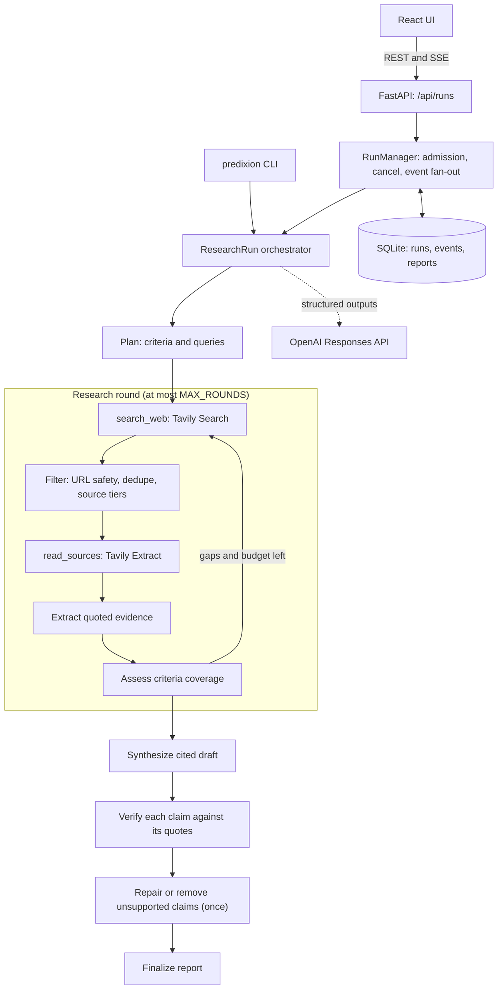

# Predixion AI

[](https://predixion-ai-8840249691.asia-south1.run.app)
[](https://www.youtube.com/watch?v=WW-NYzoHdD0)
[](https://github.com/Hardik182005/Predixion-AI/actions/workflows/ci.yml)
<br>
[](pyproject.toml)
[](https://fastapi.tiangolo.com)
[](frontend/package.json)
[](frontend/package.json)
[](frontend/package.json)
[](https://github.com/astral-sh/ruff)
[](https://github.com/astral-sh/uv)

**Clear answers. Evidence you can inspect.**

Predixion AI is a bounded research agent. It takes a question that needs several sources, searches the web, reads the most useful pages, extracts quoted evidence, fills gaps with targeted follow-up searches, and writes a report in which every claim cites the passages that support it. Claims that the cited passages do not support are removed or qualified before the report is shown. When the evidence is thin, the report says so instead of guessing.

It has a web UI, a REST + Server-Sent Events API, and a CLI. A fixture mode runs the full pipeline offline against synthetic sources, for demos and tests, at no cost.

**Try it: https://predixion-ai-8840249691.asia-south1.run.app** · **[Demo video](https://www.youtube.com/watch?v=WW-NYzoHdD0)**

[](https://www.youtube.com/watch?v=WW-NYzoHdD0)

The hosted demo runs on Google Cloud Run. Fixture runs are free and unlimited. Live web research is open to everyone within a shared limit of 20 live runs a day and 3 per visitor an hour. Run history lasts only while the server instance is up (it scales to zero after about 15 idle minutes), so export reports you want to keep. See [docs/deployment.md](docs/deployment.md).

- [Requirements and how they map to the code](docs/requirements.md)
- [Security model](docs/security.md)
- [Evaluation method and results](docs/evaluation.md)
- [Sample reports](docs/samples/)
- [Deployment on Cloud Run](docs/deployment.md): architecture, access model, limits, costs, and operations
- [Demo script](docs/demo-script.md) · [Submission notes](docs/submission.md) · [AI usage](AI_USAGE.md)
- [Independent audit](docs/audit.md): requirement-by-requirement verification, defects found and fixed, and what remains

## Quick start

Requirements: Python 3.13 with [uv](https://docs.astral.sh/uv/), Node.js 24 for the frontend.

```bash
uv sync                                   # Python dependencies from uv.lock
cp .env.example .env                      # fixture mode works with no keys
uv run predixion samples                  # list the sample questions
uv run predixion ask "Compare the top three open-source vector databases for a startup building RAG products." --mode fixture

cd frontend && npm ci && npm run build && cd ..
# In .env: SERVE_FRONTEND_DIR=frontend/dist
uv run predixion serve                    # http://127.0.0.1:8000
```

For frontend development, run `uv run predixion serve` and, in `frontend/`, `npm run dev` (http://127.0.0.1:5173, proxies `/api` to port 8000).

With Docker: `docker compose up --build`. The image builds the frontend and serves both on `127.0.0.1:8000`. compose.yaml publishes the port on host loopback only. To expose it more widely, switch to token auth (see [Configuration](#configuration)).

### Live mode

Live mode needs two keys in `.env`: `OPENAI_API_KEY` and `TAVILY_API_KEY`. Set `PREDIXION_MODE=live` to make it the default, or pass `--mode live` / choose "Live web research" in the UI. The keys stay on the server. They are never sent to the browser, logged, or written to reports.

`GROQ_API_KEY` is optional. With it, small tasks run on Groq and every task can fall back between OpenAI and Groq; see [Model routing](#model-routing).

In the evaluation, a live run took 25–90 seconds and cost $0.03–$0.10 with the default round and page limits. Costs are estimated from list prices; see [docs/evaluation.md](docs/evaluation.md).

## Usage

### UI

- `/`: landing page. "View sample" starts a fixture run of a sample question.
- `/research`: ask a question, pick live or fixture mode, and watch the run.
  - Progress shows the plan, each stage, criteria coverage as it is assessed, and an activity log.
- The report contains:
  - A short answer and key findings.
  - A comparison table, or the list of matching organizations.
  - Conflicts between sources, and missing evidence.
  - Criteria coverage, confidence, and next steps.
  - Collapsible execution details: searches, pages, model calls, tokens, cost, and timings.
- Each citation opens the quoted passage, its source, its date, and its caveats.
- Runs can be cancelled, retried, and exported as Markdown or JSON.

### CLI

```bash
uv run predixion ask "question" [--mode live|fixture] [--max-rounds N] [--seed-url URL] [--json] [--out FILE]
uv run predixion serve [--host H] [--port P]
uv run predixion samples
uv run predixion token --user NAME        # prints a new token and the API_TOKEN_HASHES line for it
uv run predixion eval --mode fixture      # offline regression suite
uv run predixion eval --mode live --max-spend 1.0 --save-reports DIR
uv run predixion deps report.json --source S3   # offline: which claims depend on one source
uv run predixion metrics report.json            # execution metrics and stage timings of a saved report
```

### API

All errors use the shape `{"error": {"code": "...", "message": "..."}}`.

| Method and path | Purpose |
|---|---|
| `POST /api/runs` | Start a run. Body: `{"question", "mode"?, "max_rounds"?, "seed_urls"?}` (question 8–1000 characters, at most 3 seed URLs, 1–4 rounds). Returns `202 {"run_id", "status", "reused"}`. An `Idempotency-Key` header returns the same run when a request is retried. |
| `GET /api/runs` | Recent runs of the caller. |
| `GET /api/runs/{run_id}` | Status, metrics, and the report once there is one. |
| `GET /api/runs/{run_id}/events` | SSE progress stream. Resumes after `Last-Event-ID`; ends with a status event whose `data.terminal` is true. |
| `POST /api/runs/{run_id}/cancel` | Cancel a queued or running run. |
| `GET /api/runs/{run_id}/export?format=md\|json` | Download the report. |
| `GET /api/runs/{run_id}/dependencies?source=S3` | Offline source-dependency analysis of the stored report: which claims would lose every citation without that source (and its recorded copies). No provider calls. |
| `DELETE /api/runs/{run_id}` | Delete a run. |
| `GET /api/config`, `GET /api/samples` | UI configuration and sample questions. |
| `GET /healthz`, `GET /readyz` | Liveness and readiness. On Cloud Run, Google's front end reserves `/healthz`; use `/readyz`. |

Run IDs match `^run_[0-9a-f]{24}$`. Anything else is rejected before any lookup.

**`/api/runs` instead of `/research`.** The assignment describes a `/research` endpoint. This API uses `/api/runs` because a research request is a long-running job: POST creates the job, and the client then follows it, reconnects, cancels it, or exports it. This keeps the API under one `/api` prefix and leaves `/research` free for UI routes. A synchronous `/research` that blocked for a minute would time out behind most proxies and could not report progress.

**Execution guarantees.** Runs execute as asyncio tasks inside the server process. A run's time limit starts when it gets an execution slot, not when it is queued. They are not durable: if the process stops, active runs are marked `interrupted` on the next start, and their clients receive a terminal event. Delivery is not exactly-once. Events are numbered, persisted, and replayed after `Last-Event-ID`, and the client discards duplicates. If the report cannot be saved when a run ends, the run is still released and its terminal event says `persisted: false`; the UI tells the user nothing was kept, and the next start marks the run interrupted. Durable terminal state is not guaranteed while the database is unavailable. Idempotency keys are scoped to the caller. Reusing a key with a different request body returns `409 idempotency_conflict`.

## Architecture



Source layout (`src/predixion/`):

| Module | Responsibility |
|---|---|
| `orchestrator.py` | The workflow above. Every stop condition lives here: criteria satisfied, rounds, diminishing returns, deadline, cost, pages, cancellation. |
| `tools.py` | The two tools, `search_web` and `read_sources`; the Tavily REST client, caching, credit accounting, and fault injection for tests. |
| `llm.py` | OpenAI (Responses API) and Groq (Chat Completions) adapters with strict JSON schemas; per-task model routes and fallback; per-run token and cost reservation. |
| `reliability.py` | Error classification, the single retry owner, deadlines, and budgets. |
| `sources.py`, `urls.py` | Source cleaning, classification, prompt-injection screening, passage chunking, URL validation and canonicalization. |
| `grounding.py` | Quote validation, criteria coverage, claim checks, and confidence. This is deterministic code, not model output. |
| `runs.py`, `store.py`, `api.py` | Run lifecycle, SQLite persistence, HTTP and SSE. |
| `evals.py`, `fixtures/` | Evaluation suite and the offline fixture world. |

The frontend lives in `frontend/`: React 19, Vite, TypeScript and Tailwind, with no UI framework and no client-side secrets.

## Approach and the questions the assignment asks

### Why is an agent appropriate?

Questions like "compare the top three X" or "find five companies that…" cannot be answered from one search. The answer depends on what the first round finds: which candidates exist, which criteria still lack evidence, and whether sources disagree. That calls for a loop: search, read, check coverage, then search again for what is missing.

The agent's freedom is deliberately narrow:
- The model proposes plans, evidence, and claims as structured data.
- Ordinary application code decides which tools run, how many rounds happen, what counts as evidence, and when to stop.

The evaluation compares this loop with a one-pass baseline on the same model, so the extra cost and latency are measured, not assumed.

### Which tools were chosen and why?

There are two tools:
- `search_web` uses [Tavily Search](https://docs.tavily.com/).
- `read_sources` uses Tavily Extract.

One provider covers both search and clean page text. The responses carry the publication dates and scores the filters need. The application never fetches pages itself, which removes a whole class of SSRF risk from this server (see [docs/security.md](docs/security.md)).

The model is OpenAI `gpt-6.1-terra` at reasoning effort `low`, called through the Responses API with strict JSON schemas. List prices are $1 / $5 per million input/output tokens, checked on 2026-10-28. It was chosen as the lowest-cost model that held up on this pipeline's structured extraction and verification steps. The cheaper `gpt-6-luna` was evaluated against it; see [docs/evaluation.md](docs/evaluation.md). The model is configurable with `RESEARCH_MODEL` and its prices.

<a id="model-routing"></a>**Model routing (optional Groq).** With `GROQ_API_KEY` set, each model task has an ordered list of models:
- Tasks in `GROQ_TASKS` (default `plan,follow_up`) try `openai/gpt-oss-120b` on Groq, then `openai/gpt-oss-20b` on Groq, then the OpenAI model. These are small requests, and Groq's list prices are lower ($0.15 / $0.60 and $0.075 / $0.30 per Mtok, checked on 2026-10-28).
- Every other task tries the OpenAI model first, then the two Groq models.
- A Groq model is skipped when the request (input estimate plus output cap) is larger than `GROQ_MAX_REQUEST_TOKENS` (default 8,000, a free-tier tokens-per-minute limit). Extraction and synthesis therefore stay on OpenAI.
- When a model fails, the task moves on to the next model instead of retrying. Only the last model gets the normal retries. Refusals are not retried elsewhere.
- An auth or quota error rules that provider out for the rest of the run.
- Every attempt counts toward the run's attempt, token, and cost limits, priced at the model that served it. Before a call, the budget check assumes the priciest model the task may use.
- Reports list the models that served each run and how many fallbacks happened.

Groq is called through its OpenAI-compatible Chat Completions endpoint with the same strict JSON schemas. `MODEL_FALLBACK=false` turns fallback off. Routing has not been evaluated for answer quality; see [docs/evaluation.md](docs/evaluation.md#limits-of-this-evaluation).

**Tavily setup ("Path B").** Tavily's agent-setup guide offers two paths:
- Install the Tavily CLI or plugins and sign in with OAuth.
- Call the REST API with an API key.

This project uses the REST path: `httpx` calls `https://api.tavily.com` with `TAVILY_API_KEY`, read from the gitignored `.env`. The global CLI, OAuth login, and editor plugins were not installed. The server only needs a server-side key, and a global CLI or OAuth session would add credentials and machine-wide state the application does not use. The provider endpoints are constants in code, so an environment variable cannot redirect traffic.

**Why not LangGraph?** The workflow is a fixed sequence with one bounded loop. Plain asyncio code made the stop conditions, retry ownership, budget reservation, and cancellation explicit and testable without a framework runtime.

What this gives up:
- Durable checkpointing and resumable graphs, which LangGraph would provide. Here an interrupted run is marked interrupted, not resumed.
- Built-in graph visualization and tracing integrations.

Adding persistence or human-in-the-loop steps would make a graph framework more attractive.

### How are bad tool results handled?

- **Classified errors.** Provider failures are classified as rate limit, timeout, unavailable, auth, bad request, or bad output. Only transient kinds are retried, with backoff that honors `Retry-After`. SDK retries are off, so every attempt is counted once.
- **Bounded runs.** Each run has a deadline, a token and cost budget reserved before each model call, and caps on rounds, queries, and pages.
- **Partial page failures.** Pages that fail to load are recorded per item and the run continues. If every page fails, or search is down, the run ends with a clear status (`failed`, `insufficient_evidence` or `partial`) and an explanation, never an invented answer.
- **Status semantics.** `insufficient_evidence` is a verdict about pages that were read. A run cut off before it could extract any evidence (provider outage, bad credentials, the time or cost limit, unusable model output) ends `failed` with the stop reason that cut it off, so a timeout is never reported as "no relevant sources".
- **Filtered results.** Search results are filtered before reading: unsafe URLs, duplicates, near-duplicate content, non-text files, and paywalled pages are dropped.
- **Fault injection.** Behind `ENABLE_FAULT_INJECTION`, it is disabled in production. Tests and the UI's "simulate a failure" control use it to exercise search outages, rate limits, empty results, failed pages, and malformed model output.

### How are hallucinations reduced?

1. **Evidence is quoted.** The model must copy a passage from a page. A quote that does not appear in the page text after normalization is rejected.
2. **Claims cite evidence IDs.** Citations to unknown IDs are removed. Inline markers such as "(E3)" are moved into the citation list.
3. **Every claim is verified** against only the passages it cites. Unsupported claims are repaired once and otherwise removed, and partly supported claims are qualified.
4. **Coverage is computed by code**, per criterion and, for comparisons and discovery, per entity. A compound requirement the planner lists in parts ("open-source core" and "license identified") becomes one criterion per part, so a parent counts as covered only when every part has evidence. Evidence for one candidate never satisfies, or freshens, another candidate's requirement, and the coverage note names the entities that still lack evidence. A comparative criterion supported only by first-party (vendor) sources counts as weak. A criterion backed only by old or undated sources is marked stale.
5. **Discovery lists are never padded.** An entity is listed only if evidence shows it meets every eligibility condition.
6. **Page text is data, not instructions.** It is screened for instruction-like text and passed to the model inside delimited blocks, and the model has no tools to call.

These measures check that claims match their sources. They cannot check that the sources are right.

**Confidence** (High, Medium, Low) is computed by code from the evidence the surviving claims actually cite, not from everything retrieved: uncited pages and copies of a cited page cannot raise it, comparative criteria need independent evidence, a removed short answer or an unresolved conflict rules out High, and one authoritative source can establish a narrow documented fact. The rubric is in [docs/evaluation.md](docs/evaluation.md#confidence-rubric); it is not calibrated and shows no probabilities.

**Conflicts** found by code (opposite-polarity evidence about the same entity and criterion) are shown with both sides' claims, citations, and dates, and labelled "possible conflict, needs review", because the code checks only that the passages address the same entity and criterion, not the same version or conditions. Conflicts the model describes and resolves say how they were resolved.

**Source dependencies.** The evidence drawer, `predixion deps`, and `GET /api/runs/{id}/dependencies` answer "what depends on this source?" from the report's own claim graph, offline: which claims would lose every citation without it, which keep some. It is a dependency analysis, not a new fact check.

### What remains before public production use?

- **Durable job execution.** A queue and worker, so runs survive restarts and can scale beyond one process.
- **Identity and abuse controls.** Real user accounts or SSO instead of static tokens and browser-generated visitor ids, durable per-user quotas, and rate limiting at the edge. Today live runs have a service-wide daily limit that survives restarts and a per-user hourly limit held in memory, which a visitor can sidestep by changing id.
- **Isolated fetching.** An SSRF-hardened fetch path, if pages are ever fetched by this service instead of by the provider.
- **Larger evaluation.** A bigger evaluation set with human-labelled answers. The current suite is small, was used during development, and is scored by a lexical heuristic.
- **Accuracy and policy work.** Price and model drift checks, source licensing review, and privacy review of stored questions and reports.
- **Accessibility audit.** A manual screen-reader pass. The automated axe scans pass.

### What would be monitored?

- **Run outcomes:** status mix (completed / partial / insufficient / failed) and stop reasons per day.
- **Latency:** p50/p95 per run and per stage, plus time to first event.
- **Cost:** per run and per day, tokens, Tavily credits, and how often budget or deadline stops occur.
- **Providers:** error rates by kind and retry counts.
- **Evidence quality:** the evidence rejection rate (quotes not found), claims removed or qualified by verification, the share of reports with unresolved criteria, and the share of code-detected conflicts.
- **Persistence:** terminal events with `persisted: false` (a run finished but its report could not be saved) and runs marked interrupted at startup.
- **Safety and capacity:** injection-screen hits, SSE connection counts, and queue depth.

Structured JSON logs already carry run ID, status, stop reason, duration, model calls, and cost. They contain no question text unless `LOG_CONTENT=true`.

### Key tradeoffs

- **Latency and cost for coverage.** In the live evaluation, the agent covered twice as many criteria as the one-pass baseline (12 vs 6 of 30). It took a median 66 s instead of 8 s and cost 2.3× more.
- **Strictness over fluency.** Verification removes or qualifies claims, so answers are sometimes shorter or more hedged than a plain LLM answer.
- **One provider for search and reading.** This is simpler and safer, and it is a single point of failure. Failures degrade to an explained status rather than a fallback provider.
- **In-process jobs over a queue.** This makes local setup simple, at the cost of durability.
- **Lexical evaluation scoring.** It is cheap, deterministic, and cannot be fooled by fluent text, but it under-credits correct claims that paraphrase or combine passages. It is a lower bound, not a correctness verdict.

## Configuration

Everything is set through environment variables or `.env`; see [.env.example](.env.example). Important ones:

| Variable | Default | Notes |
|---|---|---|
| `PREDIXION_MODE` | `fixture` | `live` needs both API keys. |
| `RESEARCH_MODEL`, `RESEARCH_REASONING_EFFORT` | `gpt-6.1-terra`, `low` | Set `MODEL_INPUT_USD_PER_MTOK` / `MODEL_OUTPUT_USD_PER_MTOK` to match the model. |
| `GROQ_API_KEY`, `GROQ_TASKS`, `GROQ_MODEL`, `GROQ_FALLBACK_MODEL` | unset, `plan,follow_up`, `openai/gpt-oss-120b`, `openai/gpt-oss-20b` | Optional; see [Model routing](#model-routing). Prices: `GROQ_*_USD_PER_MTOK`. |
| `GROQ_MAX_REQUEST_TOKENS`, `MODEL_FALLBACK` | 8000, `true` | Largest request sent to Groq; whether a failed task moves on to the next model. |
| `MAX_ROUNDS`, `MAX_PAGES_PER_RUN`, `RUN_DEADLINE_S`, `MAX_COST_USD_PER_RUN` | 2, 8, 120, 0.60 | Per-run limits. |
| `AUTH_MODE`, `API_TOKEN_HASHES` | `none` | `none` is refused on non-loopback binds unless `ALLOW_UNAUTHENTICATED_BIND=true`. |
| `PUBLIC_ACCESS` | `none` | With token auth, what callers without a token may do: `none`, `fixture`, or `live`. Their runs are scoped by a random id the browser sends. |
| `LIVE_RUNS_PER_DAY`, `LIVE_RUNS_PER_USER_PER_HOUR` | 0, 0 (off) | Admission limits for live runs; over a limit returns 429 with `Retry-After`. The daily limit times `MAX_COST_USD_PER_RUN` bounds daily provider spend. |
| `LIVE_LEDGER_PATH` | unset | File that keeps the daily live-run count across restarts. If it cannot be read or written, live runs are refused. |
| `HSTS_MAX_AGE_S` | 0 | Sends `Strict-Transport-Security` when above 0. HTTPS deployments only. |
| `SERVE_FRONTEND_DIR` | unset | Serve the built UI from the API process. |
| `ENABLE_FAULT_INJECTION` | `false` | Testing only; ignored in production. |

## Development

```bash
uv run pytest                      # backend tests (live tests skipped unless PREDIXION_LIVE_TESTS=1)
uv run ruff check . && uv run ruff format --check .
cd frontend
npm test                           # Vitest unit and component tests
npm run build                      # typecheck and production build
npm run e2e                        # Playwright against the real API in fixture mode (build first)
```

CI (`.github/workflows/ci.yml`) runs:
- Backend: lint, tests, and the fixture evaluation.
- Frontend: typecheck, unit tests, build, and Playwright with axe.
- `pip-audit`, `npm audit`, gitleaks, and a Docker build.

## Known limitations

- Results depend on what Tavily returns. Search results vary between runs, and paywalled or very new pages are often missing.
- Verification checks claims against quotes, not quotes against reality. A wrong source can produce a confidently cited wrong claim.
- Live runs take about a minute. The default 120 s deadline can end a run with a partial answer.
- Cost figures are estimates from configured list prices, not invoices.
- Groq routing has only a few live runs behind it (the audit and improvement runs in `evals/results/`); plans and follow-ups from the Groq-hosted models may differ in quality from OpenAI's. The full suite was run before routing existed.
- Confidence depends on the planner listing the parts of a compound criterion. If it bundles two requirements into one criterion without parts, coverage is judged on the pair as one; the prompt asks for parts, and the live samples before this change show what the bundling looked like ([docs/evaluation.md](docs/evaluation.md#spot-check-of-live-claims)).
- Discovery questions can return far fewer entities than requested, because entities are included only when the pages read state every condition.
- Runs are not durable across restarts (see [Execution guarantees](#api)). On the hosted demo, history and reports disappear when the instance scales to zero or is redeployed.
- The evaluation suite is small (8 scenarios). It was used during development, so its results are optimistic for unseen questions.

## Future improvements

- A second search or extraction provider as a fallback.
- Durable runs on a job queue, with resumption.
- Streaming the answer as it is synthesized.
- A larger evaluation set with human-labelled references, and periodic live runs to track drift.
- Per-user history, sharing, and saved source lists.
