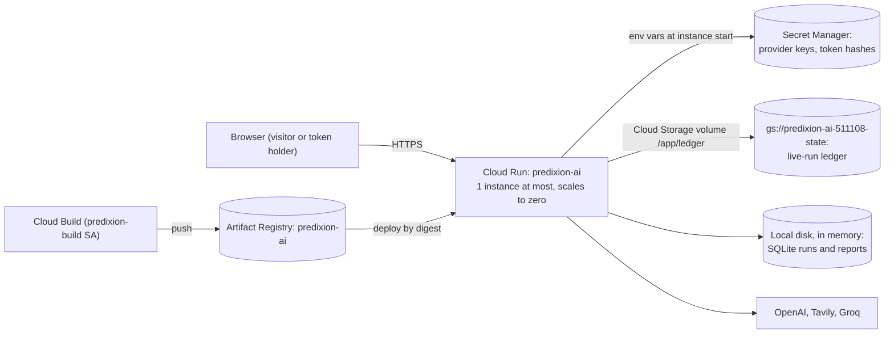

# Deployment on Google Cloud Run

Predixion AI runs as its own Cloud Run service, `predixion-ai`, in the existing Google Cloud project `quantfolio-511108` (region `asia-south1`, Mumbai). It shares that project with QuantFolio and nothing else: every resource below is new, named `predixion-*`, and labelled `app=predixion-ai`.

**URL: https://predixion-ai-8840249691.asia-south1.run.app** (also served at `https://predixion-ai-t3tnxwlogq-el.a.run.app`)

| Deployed | Value |
|---|---|
| Revision | `predixion-ai-00005-9wh`, serving 100% of traffic |
| Commit | `ab4ab22` on `feature/live-budget-note` (pull request #13). It adds the small-live-budget note to the question form and `live_runs_per_day` to `/api/config`. |
| Image | `asia-south1-docker.pkg.dev/quantfolio-511108/predixion-ai/predixion-ai@sha256:9f03da4af441e2dce64ea743008df6f9459497f330286db28f0b9dc64c50d182` |
| Verified | 2026-10-29; see [Verification](#verification) |

## Architecture



- **One container** serves the API and the built React UI (`SERVE_FRONTEND_DIR`, set in the Dockerfile). It runs as the non-root user `predixion` (uid 10001).
- **Secrets** come from Secret Manager as environment variables (`--set-secrets`). They are not in the image, the build context, the repository, or any log. The runtime service account can read only its four secrets.
- **Runs** are asyncio tasks in the instance's memory, and SQLite lives on the instance's local disk, which Cloud Run keeps in memory. That is why the service is limited to one instance; see [What is not kept](#what-is-not-kept).
- **The live-run ledger** (`LIVE_LEDGER_PATH=/app/ledger/live-runs.json`) is the only state on durable storage: a JSON list of live-run start times from the last 24 hours, on a Cloud Storage volume. It keeps the daily live-run limit in force across restarts, scale-to-zero, and deploys.

| Setting | Value | Why |
|---|---|---|
| `--max-instances` / `--min-instances` | 1 / 0 | Runs and SQLite are per instance, so a second instance would split users' history. Zero minimum means no cost while idle. |
| `--no-cpu-throttling` | on | A run keeps working after the browser stops watching, between requests. Billed per instance-second while the instance is up. |
| `--cpu` / `--memory` | 1 / 1 GiB | Runs are I/O-bound; the in-memory disk holds the SQLite file. |
| `--concurrency` | 60 | Each run's event stream holds a request open. |
| `--timeout` | 300 s | Above the 120 s run deadline, so an event stream can follow a whole run. |
| `--execution-environment` | gen2 | Needed for Cloud Storage volumes. |
| `--allow-unauthenticated` | on | The app does its own access control (below). |

## Access model and limits

`AUTH_MODE=token` with `PUBLIC_ACCESS=live`:

- **Visitors** (no token) can run fixture research and live research. The browser sends a random id (`X-Visitor-Id`, kept in local storage) that scopes the visitor's run history. It is not a credential: anyone with the id can read that visitor's runs, and a visitor can get a new one by clearing site data.
- **Token holders** send `Authorization: Bearer <token>`. One owner token exists; its hash is in the `predixion-api-token-hashes` secret and the token itself in `predixion-owner-token`, which has no IAM bindings of its own (the service cannot read it; people with project-level Secret Manager access can). A wrong or unknown token is rejected with 401; it never falls back to visitor access.
- **No token is in the frontend bundle, a URL, or this repository.**

| Limit | Value | Applies to |
|---|---|---|
| `LIVE_RUNS_PER_DAY` | 20 per rolling 24 hours | Every live run, visitors and token holders together. Kept in the ledger. |
| `LIVE_RUNS_PER_USER_PER_HOUR` | 3 | Each visitor id or token user. Fairness only, since a visitor can change id; held in memory. |
| `MAX_COST_USD_PER_RUN` | $0.30 | Estimated provider cost per live run, reserved before each model call. |
| `MAX_CONCURRENT_RUNS` / `MAX_QUEUED_RUNS` | 3 / 6 | All runs. |
| `RUN_RETENTION_DAYS` | 1 | Stored runs, while the instance lives. |

Over a limit, the API returns `429 rate_limited` (or `capacity`) with `Retry-After`. If the ledger cannot be read or written, live runs are refused with `503 live_unavailable` and fixture runs keep working, so a storage fault cannot let live runs past the daily limit.

**Worst-case provider spend is $6 per day** (20 runs × $0.30). In the evaluation a live run cost $0.03–$0.10, so a day at the limit is more likely $0.60–$2.

Fault injection is off: the image sets `PREDIXION_ENV=production`, which ignores `ENABLE_FAULT_INJECTION`.

## What is not kept

- **Run history and reports** live on the instance. They are lost when the instance stops: after about 15 idle minutes (scale to zero), on every deploy, and whenever Cloud Run replaces the instance. Users should export reports they want to keep.
- **A run in progress** when the instance stops is lost; its client sees the stream end. The orchestrator cannot mark it interrupted, because the database goes with the instance.
- **The per-user hourly counters** reset with the instance. The daily limit does not, because it is in the ledger.
- During a deploy, the old and new revisions can overlap for a short time. Each keeps its own ledger copy in memory and writes the whole file, so live runs admitted by the old revision in that window can be missing from the new one's count. This is at most a few runs.

Durable history would need a managed database (Cloud SQL or Firestore) and a job queue, which this deployment deliberately does not add.

## Cost estimate

Prices checked on 2026-10-29 from Google's pricing pages and search results. Mumbai's Cloud Run price tier was not confirmed, so the range runs from Tier 1 to Tier 2 rates. Free tiers are per billing account and shared with QuantFolio.

| Item | Basis | Estimate |
|---|---|---|
| Cloud Run instance | Instance-based billing: $0.000018–0.0000216 per vCPU-second plus about $0.000002 per GiB-second. 1 vCPU + 1 GiB ≈ $0.07–$0.09 per hour the instance is up. The instance stays up about 15 minutes after the last request. Free: 200,000–240,000 vCPU-seconds a month (55–67 instance-hours). | Idle: $0. A few demo sessions a day (≈ 2–3 hours up): $4–$8 a month before the free tier. Never idle: $52–$62 a month, the most `max-instances=1` allows. |
| Model and search providers | Daily ledger limit × per-run cost cap | At most $6 a day; typically $0.03–$0.10 per live run. Fixture runs cost nothing. |
| Artifact Registry | About 83 MB per image; the cleanup policy keeps the 5 newest and deletes images older than 30 days. 0.5 GB free, then about $0.10 per GB-month. | About $0 |
| Secret Manager | 5 secret versions; 6 free per billing account, then about $0.06 each a month. Reads happen at instance start. | Under $0.50 a month |
| Cloud Build | About 1 minute per deploy on e2-standard-2 ($0.006 per minute). 2,500 free minutes a month. | About $0 |
| Cloud Storage | Build sources and logs (deleted after 14 days) and a ledger file under 1 KB. | Under $0.05 a month |
| Logging and egress | A few log lines per run; a few hundred KB of UI and API traffic per visit. | Within free allowances at demo scale |

Things to know:

- **A billing budget only alerts. It does not stop spending.** The hard limits here are `max-instances=1` and the live-run limits in the app. For a second line of defense, set monthly usage limits in the OpenAI, Tavily, and Groq dashboards.
- If the billing account is on the free trial, its credits cover these charges. When the trial ends, the same usage is billed to the account.
- To remove the provider spend entirely, set `PUBLIC_ACCESS=fixture` (below).

## Deploying

The one-time setup is below. After that, deploying a commit is one command from the repository root, in Git Bash or any POSIX shell with `gcloud`:

```bash
GCP_ACCOUNT=you@example.com deploy/deploy.sh [git-ref]      # default HEAD
```

`deploy/deploy.sh`:
1. Archives the commit with `git archive`, so only tracked files are sent: never `.env`, local notes, or untracked files. Line endings are forced to LF.
2. Builds it with Cloud Build ([`deploy/cloudbuild.yaml`](../deploy/cloudbuild.yaml)) in `asia-south1` as the `predixion-build` service account, with sources and logs in the dedicated build bucket. The image is tagged with the commit hash.
3. Deploys that image to Cloud Run by digest, with every setting above, and prints the URL and revision.

Every `gcloud` call names the account, project, and region explicitly; the script never changes `gcloud config`.

### One-time setup

These are the commands that created the deployment, with the account in `$A`. They require Owner (or the equivalent admin roles) on the project. The required APIs (Cloud Run, Cloud Build, Artifact Registry, Secret Manager, Cloud Storage) were already enabled, and no project-level IAM binding was added or changed.

```bash
A=--account=you@example.com; P=--project=quantfolio-511108; R=asia-south1
RUN=serviceAccount:predixion-run@quantfolio-511108.iam.gserviceaccount.com
BUILD=serviceAccount:predixion-build@quantfolio-511108.iam.gserviceaccount.com

# Image registry, with a cleanup policy
gcloud artifacts repositories create predixion-ai $A $P --location=$R --repository-format=docker \
  --description="Predixion AI container images" --labels=app=predixion-ai
gcloud artifacts repositories set-cleanup-policies predixion-ai $A $P --location=$R \
  --policy=deploy/registry-cleanup-policy.json --no-dry-run

# Build bucket (sources and logs, deleted after 14 days) and the ledger bucket
for b in predixion-ai-511108-build predixion-ai-511108-state; do
  gcloud storage buckets create gs://$b $A $P --location=$R \
    --uniform-bucket-level-access --public-access-prevention --default-storage-class=STANDARD
  gcloud storage buckets update gs://$b $A $P --update-labels=app=predixion-ai
done
gcloud storage buckets update gs://predixion-ai-511108-build $A $P --lifecycle-file=deploy/build-bucket-lifecycle.json

# Service accounts, each granted roles on its own resources only
gcloud iam service-accounts create predixion-build $A $P --display-name="Predixion AI build"
gcloud iam service-accounts create predixion-run $A $P --display-name="Predixion AI runtime"
gcloud artifacts repositories add-iam-policy-binding predixion-ai $A $P --location=$R \
  --member=$BUILD --role=roles/artifactregistry.writer
gcloud storage buckets add-iam-policy-binding gs://predixion-ai-511108-build $A $P \
  --member=$BUILD --role=roles/storage.admin
gcloud storage buckets add-iam-policy-binding gs://predixion-ai-511108-state $A $P \
  --member=$RUN --role=roles/storage.objectAdmin
```

Secrets are created with replication in `asia-south1` only. The value is read from standard input, so it never appears in a command line, shell history, or log. `read -rs` does not echo what you type:

```bash
for s in predixion-openai-api-key predixion-tavily-api-key predixion-groq-api-key; do
  read -rsp "$s: " value && echo
  printf '%s' "$value" | gcloud secrets create $s $A $P --replication-policy=user-managed \
    --locations=$R --labels=app=predixion-ai --data-file=-
  gcloud secrets add-iam-policy-binding $s $A $P --member=$RUN --role=roles/secretmanager.secretAccessor
done
unset value
```

For the owner token, `uv run predixion token --user owner` prints a new token and its `API_TOKEN_HASHES` line. Store the hash line in `predixion-api-token-hashes` (and grant `predixion-run` access to it as above). Store the token in `predixion-owner-token`, and grant nobody access to that one. Several users are comma-separated: `alice:<hash>,bob:<hash>`.

## Operating it

All commands take `$A $P` (account and project) as above.

| Task | Command |
|---|---|
| Owner token | `gcloud secrets versions access latest --secret=predixion-owner-token $A $P` (prints the token; do not paste it anywhere public). In the UI, use "Enter an access token". |
| Logs | `gcloud logging read 'resource.type="cloud_run_revision" AND resource.labels.service_name="predixion-ai"' $A $P --limit=50`. Logs carry run IDs, status, timings, and cost, never question text or keys. |
| Live-run ledger | `gcloud storage cat gs://predixion-ai-511108-state/live-runs.json $A $P` (Unix start times of the last day's live runs). |
| Restrict live research to token holders | `gcloud run services update predixion-ai $A $P --region=$R --update-env-vars=PUBLIC_ACCESS=fixture`. Visitors keep fixture mode; the UI asks for a token for live mode. `PUBLIC_ACCESS=none` requires a token for everything. Update `deploy/deploy.sh` too, or the next deploy turns it back on. |
| Change a limit | Same, with `--update-env-vars=LIVE_RUNS_PER_DAY=10` (or any variable in [.env.example](../.env.example)). |
| Rotate a key | `printf '%s' "$value" \| gcloud secrets versions add predixion-openai-api-key $A $P --data-file=-` after `read -rs value`, then redeploy so the instance reads the new version. Disable the old version with `gcloud secrets versions disable`. |
| Roll back | `gcloud run revisions list --service=predixion-ai $A $P --region=$R`, then `gcloud run services update-traffic predixion-ai $A $P --region=$R --to-revisions=REVISION=100`. Traffic then stays pinned to that revision, so after the next deploy run `update-traffic` again with `--to-latest`. |
| Stop public access | `gcloud run services remove-iam-policy-binding predixion-ai $A $P --region=$R --member=allUsers --role=roles/run.invoker`. Every request then gets 403 from Google before reaching the app; nothing is deleted. Add the binding back (`add-iam-policy-binding`, same flags) to reopen it. |

### Removing the deployment

Each of these deletes only a Predixion resource. None touches QuantFolio.

```bash
gcloud run services delete predixion-ai $A $P --region=$R
gcloud artifacts repositories delete predixion-ai $A $P --location=$R
gcloud storage rm --recursive gs://predixion-ai-511108-build gs://predixion-ai-511108-state $A $P
for s in predixion-openai-api-key predixion-tavily-api-key predixion-groq-api-key \
         predixion-api-token-hashes predixion-owner-token; do gcloud secrets delete $s $A $P; done
gcloud iam service-accounts delete predixion-run@quantfolio-511108.iam.gserviceaccount.com $A $P
gcloud iam service-accounts delete predixion-build@quantfolio-511108.iam.gserviceaccount.com $A $P
```

## Verification

These checks ran on 2026-10-29. A script called the public URL with fresh random visitor ids. It read the owner token from Secret Manager into memory and never printed it.

The free checks ran on revision `predixion-ai-00004-jbb` (commit `034ae88`). The paid live checks and the restart check ran on revisions `-00002-brv` and `-00003-tmf`. Those have the same application code; `034ae88` changes only the layout of `deploy/deploy.sh`.

Revision `predixion-ai-00005-9wh` (commit `ab4ab22`) changes only the question form's live-budget note and one `/api/config` field. The same free checks passed on it on 2026-10-29. The served bundle contains the note, and `/api/config` reports `live_runs_per_day: 20`. No paid live runs were made for it.

| Check | Result |
|---|---|
| UI at `/` | 200 |
| Security headers | CSP with `script-src 'self'`, HSTS `max-age=31536000`, `nosniff`, `DENY` and `no-referrer` |
| `http://` | 302 to `https://` |
| `/readyz` | `{"status": "ready"}` |
| No token and no visitor id | 401 |
| Wrong bearer token, sent with a valid visitor id | 401, with no fallback to visitor access |
| Malformed visitor id | 401 |
| Visitor `/api/config` | Live research is available without a token, fault injection is off, and the cost cap is $0.30. The body holds no key material. |
| Fault injection request | 403 `fault_injection_disabled` |
| Fixture run | Completed with 6 findings. The Markdown export (9,055 characters) and the SSE replay work. |
| Another visitor opens that run | 404, and their run list is empty |
| Owner token | Accepted and sees only its own runs. A visitor's run gives 404. |
| Live run, 1 round | `partial` / `rounds_exhausted` in 37 s: estimated cost $0.059, Medium confidence, 12 sources |
| One visitor's 4th live run within an hour | 429 `rate_limited` with `Retry-After: 3563`; that visitor's fixture runs are still accepted |
| Ledger | `gs://predixion-ai-511108-state/live-runs.json` held the 3 start times |
| Daily limit across a restart | `LIVE_RUNS_PER_DAY=3` was set, which starts a new revision on a new instance. A new visitor's live run was then refused with 429 straight away, so the count came from the ledger. The next deploy restored the limit to 20. |
| Deployed settings | 1 instance at most, gen2, the volume mounted at `/app/ledger`, four secrets passed as Secret Manager references, and the limits listed above |
| Logs, all revisions (113 entries) | No `sk-`, `tvly-` or `gsk_` keys, no bearer values, no owner token and no question text |
| QuantFolio | Unchanged: generation 1, `quantfolio-api-00001-445` serving 100% |

`/healthz` at the public URL returns Google's 404 page; see [Known caveats](#known-caveats).

Verification spent about $0.06 on providers: one live run, plus two live runs cancelled straight away. Those three runs use 3 of the 20 daily live runs until about 17:47 UTC on 2026-10-30.

## Known caveats

- **`/healthz` is not reachable at the public URL.** Google's front end reserves that path and answers 404 itself before the request reaches the container. `/readyz` and every other route work. Cloud Run's own startup check uses the container port, so this does not affect health checks.
- **The default URL is the only domain.** No custom domain or load balancer is set up. HSTS is sent (`max-age=31536000`); the `run.app` domain is HTTPS-only either way.
- **No edge rate limiting.** Limits are enforced in the application. A flood of fixture requests can still keep the instance up (and billed) and fill the run queue, which is capped at 3 running and 6 queued. Cloud Armor would need a load balancer, at a fixed monthly cost.
- **Visitor ids are not identities.** The hourly per-user limit slows down a casual user; it does not stop a determined one. The daily limit is what bounds spend.
