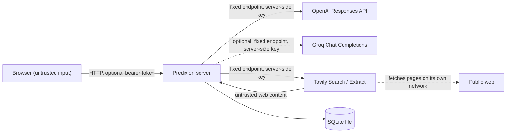

# Security model

Predixion AI is a read-only research service. It calls two external providers (OpenAI and Tavily), plus Groq when `GROQ_API_KEY` is set, stores runs in a local SQLite file, and serves a browser UI. This document describes what it protects, where the trust boundaries are, which controls exist, how they are tested, and what risk remains. It does not claim that every attack is prevented.

## Assets

| Asset | Why it matters |
|---|---|
| `OPENAI_API_KEY`, `TAVILY_API_KEY` | Direct spending power and account access. |
| API tokens (`AUTH_MODE=token`) | Access to a user's runs and to paid research. |
| Questions, reports, stored evidence | May reveal what a user is researching. |
| Provider spending | Every live run costs money. Abuse or runaway loops cost more. |
| Report integrity | Users act on the answer, so a manipulated report is a real harm. |
| The host running the server | Must not be reachable through the app (SSRF, file access). |

## Trust boundaries

1. **Browser to server.** Every request field is untrusted: question, mode, seed URLs, run IDs, idempotency keys, and headers.
2. **Web content to server.** Search snippets, page text, titles, metadata, and provider error messages are untrusted data. They may contain prompt injection, misleading claims, or hostile markup.
3. **Server to model.** The model sees the question and untrusted page passages. Its output is untrusted too: it is parsed against strict schemas and validated by code before anything is used.
4. **Tavily to the web.** Tavily fetches pages from its own infrastructure. This server never fetches arbitrary URLs. Its URL checks decide which URLs it asks Tavily to read and which links it renders. They do not and cannot control Tavily's own network behavior.

## Threats and controls

### Secret exposure

- Keys are read only from server environment or the gitignored `.env`. They are held as `SecretStr` and never placed in `/api/config`, reports, events, logs, fixtures, or the frontend bundle. The frontend has no build-time environment secrets.
- `.gitignore` excludes `.env` and `.env.*` (except `.env.example`, which has empty values). `.dockerignore` keeps `.env*` out of the image build context.
- On Cloud Run ([deployment.md](deployment.md)), keys come from Secret Manager as environment variables of the service. Only the service's own runtime account can read them, and each secret is readable only through its own binding. The image is built from a `git archive` of one commit, so untracked files such as `.env` never reach the build.
- Provider endpoints are constants in `config.py`. An attacker who can set environment variables still cannot redirect key-bearing traffic to another host.
- CI runs gitleaks over the full history.
- Tests: `tests/test_api.py::test_health_and_config` checks the config response contains no keys.

### Prompt injection through web content

The defense is structural. Instruction filtering is only a secondary layer.

- **The model has no tools.** It returns JSON matching a strict schema. Application code decides which searches and reads happen, and enforces the round, query, page, cost, and time limits. Page text cannot add a tool, change a destination, raise a budget, or alter authorization, because none of those are model-controlled.
- **Follow-up actions are allowlisted** (`search_web` or `read_sources`) and capped. A follow-up read names sources already discovered in the run by ID. The model never supplies a URL, and every URL passes validation before it is read.
- **Web text is marked as data.** It is wrapped in `<untrusted_passage>` / `<untrusted_source>` elements. Any embedded `<untrusted` tags are escaped so a page cannot close the wrapper. The instructions say this content is data, not instructions.
- **Instruction-like sentences are removed** (`sources.screen_injection`) before passages are created, and the source is flagged. This heuristic has false positives and false negatives.
- **Claims must quote the page.** A claim survives only if it cites a quote that appears in the page text and the verifier finds that the quote supports it. Injected text that has no quote behind it does not reach the report as a claim.
- **No secrets in model context.** Credentials and other users' data are never sent to the model. OpenAI calls set `store: false`. Groq has no such flag. Its stated policy keeps no inputs or outputs by default, apart from limited retention for reliability and abuse monitoring, and zero data retention can be turned on in the Groq console. Groq calls set `include_reasoning: false`, so no reasoning text is returned.

**Residual risk.** A page can still state false facts in plain prose, and those can be quoted and cited correctly. Grounding checks that a claim matches its source, not that the source is true. Source tiers, independent-domain counts, and visible conflicts reduce this risk but do not remove it.

Tests:
- `tests/test_orchestrator.py::test_injected_instructions_never_reach_the_model`
- `tests/test_sources_urls.py::test_injection_sentences_are_removed`, `::test_ordinary_text_is_not_flagged`, `::test_accept_page_strips_injection_before_passages`

### SSRF and unsafe destinations

- The application asks Tavily to read URLs; it never opens sockets to them.
- `urls.validate_public_url` is applied to seed URLs, search hits, follow-up reads, and rendered links. It rejects:
  - Schemes other than http/https.
  - Credentials in the URL.
  - Non-default ports.
  - Whitespace, control characters, and backslashes.
  - Percent-encoded or zone-scoped hosts.
  - IP literals in private, loopback, link-local, multicast, or reserved ranges, including IPv4-mapped IPv6 and alternate IPv4 notations.
  - `localhost`, `.local`, `.internal`, and metadata hostnames.
  - Single-label and numeric-TLD hosts.
- **What this does not do:** resolve DNS, defend against DNS rebinding, or follow redirects. None of these are needed while the provider does the fetching. If direct fetching is ever added, it needs a hardened fetch boundary first: validate resolved IPs at connect time, revalidate each redirect, cap time and decompressed bytes, and restrict egress.

Tests:
- `tests/test_sources_urls.py::test_dangerous_urls_are_rejected`, `::test_public_urls_are_accepted`
- `tests/test_orchestrator.py::test_unsafe_seed_url_is_ignored`

### Unsafe rendered output (XSS)

- **The React UI renders all report text as text.** There is no `dangerouslySetInnerHTML` and no Markdown-to-HTML rendering.
- **Links are filtered.** They render only if `safeHttpUrl` accepts them (http or https) and use `rel="noopener noreferrer nofollow"` with `target="_blank"`. Any other link shows "No safe link is available for this source."
- **Markdown export escapes Markdown syntax** in untrusted text and links only to safe URLs.
- **Security headers.** A strict Content-Security-Policy (`script-src 'self'`, `object-src 'none'`, `frame-ancestors 'none'`, `base-uri 'none'`), `X-Content-Type-Options: nosniff`, `X-Frame-Options: DENY`, and `Referrer-Policy: no-referrer`. With `HSTS_MAX_AGE_S` above 0 (the Cloud Run deployment uses one year), `Strict-Transport-Security` too.

Tests:
- `tests/test_render.py`
- `tests/test_api.py::test_security_headers`
- Vitest: `Report` "renders hostile page content as inert text and never links unsafe URLs"; `safeHttpUrl` cases.

### Unauthorized access and cross-user data

- **Local by default.** The server binds `127.0.0.1` by default.
- **Non-loopback binds need auth.** `predixion serve` refuses to bind elsewhere with `AUTH_MODE=none` unless `ALLOW_UNAUTHENTICATED_BIND=true`. That flag is for a container published only on host loopback, which is what `compose.yaml` does.
- **Token mode.** With `AUTH_MODE=token`, every `/api` route requires a bearer token, or a visitor id where `PUBLIC_ACCESS` allows one. Only `/healthz` and `/readyz` are open.
  - Only SHA-256 hashes of tokens are configured (`API_TOKEN_HASHES`), and comparison is constant-time.
  - `predixion token --user NAME` creates a token.
  - Tokens are never put in the frontend bundle. The user pastes one into the UI and it is kept in session storage.
- **Public access.** `PUBLIC_ACCESS=fixture` or `live` lets callers without a token use the service as visitors.
  - A visitor sends `X-Visitor-Id`, a random id its browser generates and keeps in local storage. The server stores only a hash-derived owner key (`visitor:<sha256 prefix>`).
  - The id is a scope, not a credential: anyone who has it can read that visitor's runs, and a visitor can get a new one at will.
  - A request that carries a token is judged only by the token. A wrong token gets 401; it never falls back to visitor access.
  - `PUBLIC_ACCESS=fixture` keeps live runs for token holders; the API refuses a visitor's live run and the UI asks for a token.
- **Owner scoping.** Every run lookup, event stream, cancel, export, delete, and idempotency key is scoped to the owner. Another user's run ID returns 404, not 403, so run existence is not revealed.
- **Run IDs** must match `^run_[0-9a-f]{24}$` (96 random bits) before any lookup.
- **CORS** allows only the configured origins (by default the Vite dev server on loopback).

Tests:
- `tests/test_api.py::test_token_auth_scopes_runs_to_their_owner`, `::test_token_mode_requires_hashes`, `::test_unknown_and_malformed_run_ids`
- `tests/test_api.py::test_public_fixture_access_scopes_visitors_and_keeps_live_behind_tokens`, `::test_public_access_still_rejects_bad_credentials`, `::test_public_live_access_lets_visitors_run_live`, `::test_public_access_requires_token_mode`
- `tests/test_store_runs.py::test_other_owners_cannot_see_a_run`, `::test_idempotency_is_scoped_to_owner_and_request`
- `tests/test_cli.py::test_serve_refuses_public_bind_without_auth`

### Spending abuse and resource exhaustion

- **Request limits.** Body capped at 64 KiB; question 8–1000 characters; at most 3 seed URLs; rounds 1–4.
- **Per-run limits.** Deadline, token cap, cost cap (reserved before each model call and reconciled with reported usage, keeping the worst case when usage is unknown), and caps on pages, queries, and model attempts.
- **Server limits.**
  - Concurrent and queued runs are capped; over capacity returns `429` with `Retry-After`.
  - Event streams are capped per run and in total.
  - Events per run are capped, always keeping the terminal event.
- **Duplicate paid runs.** Idempotency keys stop a retried request from starting a second run. A key reused with a different body returns `409`.
- **Live-run admission limits.** `LIVE_RUNS_PER_DAY` caps live runs across all callers in a rolling 24 hours, so daily provider spend is at most that number times `MAX_COST_USD_PER_RUN` ($6 on the Cloud Run deployment: 20 × $0.30). `LIVE_RUNS_PER_USER_PER_HOUR` spreads that allowance across callers. Over a limit returns `429 rate_limited` with `Retry-After`.
  - The daily count is written to `LIVE_LEDGER_PATH` (a Cloud Storage volume on Cloud Run) before a run is admitted, so restarts and scale-to-zero do not reset it. If the ledger cannot be written, or exists but cannot be read, live runs are refused with `503 live_unavailable`: the limit fails closed.
  - The hourly per-user counts are in memory and keyed by token user or visitor id. A visitor can change id, so they provide fairness, not a spend bound.
- **Not implemented:** durable per-user quotas tied to real identities, and edge rate limiting. Fixture runs are not counted, so a flood of them can fill the run queue (capped) and keep the instance running.

Tests:
- `tests/test_api.py::test_oversized_body`, `::test_rejected_requests`, `::test_idempotency_key`
- `tests/test_api.py::test_live_run_limits`, `::test_daily_live_limit_survives_a_restart_through_the_ledger`, `::test_live_runs_are_refused_when_the_ledger_is_unusable`
- `tests/test_store_runs.py::test_capacity_limit`, `::test_event_cap_keeps_terminal_events`
- `tests/test_reliability.py` budget tests
- `tests/test_orchestrator.py::test_cost_budget_is_enforced_before_the_first_call`

### Privacy, logging, and retention

- **Logs.** Structured JSON logs contain run IDs, status, stop reasons, timings, counts, and cost. They contain no question text or page content unless `LOG_CONTENT=true`. Keys never appear. Unexpected exceptions are logged by error type and code location (`error`, `where`), not with the exception text, because validation and provider errors can quote the request or a page; the text is added only with `LOG_CONTENT=true` (`tests/test_acceptance.py::test_unexpected_exception_text_is_logged_only_with_log_content`).
- **Storage.** Questions, events, and reports are stored in SQLite, so the database file should be treated as user data. A storage failure at the end of a run never leaves the run active in memory: the client is told the report was not saved, and the run is marked interrupted at the next start (`tests/test_acceptance.py`, finalization cases).
  - Terminal runs older than `RUN_RETENTION_DAYS` (default 7) are deleted at startup and periodically.
  - `DELETE /api/runs/{id}` removes a run immediately.
- **Search cache.** The cache holds public web results only, in memory, with TTLs.

Test: `tests/test_store_runs.py::test_purge_removes_only_old_terminal_runs`.

### Debug and fault-injection features

- Fault injection simulates provider failures for tests and demos. It works only if `ENABLE_FAULT_INJECTION=true` and the environment is not `production`. Otherwise a request carrying a `fault` field is refused, and the orchestrator ignores faults.
- The Docker image sets `PREDIXION_ENV=production`.

Tests: `tests/test_api.py::test_fault_injection_is_refused_when_disabled`, `tests/test_orchestrator.py::test_faults_are_ignored_unless_enabled`.

### Supply chain

- **Pinned dependencies.** Lockfiles are committed (`uv.lock`, `frontend/package-lock.json`). CI installs with `uv sync --frozen` and `npm ci`. Frontend dependencies use exact versions.
- **Image.** The Docker image runs as a non-root user and pins the uv binary version.
- **Scanning.** CI runs `pip-audit` (hash-checked export of runtime dependencies), `npm audit --audit-level=high`, and gitleaks. Dependabot is configured for uv, npm, GitHub Actions, and Docker.
- **Local results (2026-10-28):**
  - `pip-audit`: "No known vulnerabilities found."
  - `npm audit --audit-level=high`: "found 0 vulnerabilities."
- **Scanner limits.** These scanners only know published advisories. They do not catch malicious packages without an advisory, and gitleaks finds only secrets that match its patterns.

## Residual risks and gaps

| Risk | Status |
|---|---|
| False but well-sourced claims from a misleading page | Reduced (tiers, independent domains, conflicts shown), not prevented |
| Prompt injection that changes wording without adding uncited claims | Reduced by verification; possible in principle |
| Provider spend from public live access | Bounded by the daily live-run limit and per-run cost cap ($6 a day on Cloud Run); provider-side usage limits recommended as a second line |
| Per-user limits keyed by a client-chosen visitor id | Fairness only; real identity needed for real per-user quotas |
| Static bearer tokens, no expiry or rotation tooling | Acceptable for a demo; replace with real identity before wider use |
| No rate limiting at the edge | Gap; fixture traffic is limited only by the run queue and Cloud Run's single instance |
| Visitor history readable by anyone holding the visitor id | Accepted for a demo; the id never leaves the browser except in requests to this service |
| SQLite file not encrypted at rest | Relies on host disk protection; on Cloud Run it is in instance memory and gone when the instance stops |
| Provider-side handling of questions and pages | Governed by OpenAI's, Tavily's, and (when configured) Groq's own policies, not by this code |
| No manual screen-reader or penetration test | Not done |
